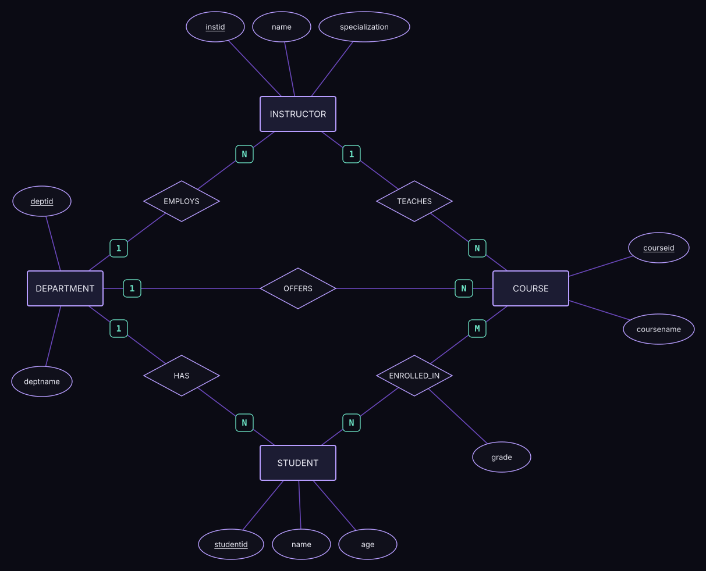

# University Database and ERD

A relational database for a university, written in SQL Server, together with the Entity Relationship Diagram (ERD) it is based on. It stores departments, instructors, students, courses, and which students are enrolled in which courses, and includes sample data and example queries.

## ERD



The diagram (Chen notation) has four entities and five relationships:

| Relationship | Connects | Cardinality | Meaning |
|---|---|---|---|
| `EMPLOYS` | Department → Instructor | 1 : N | A department employs many instructors |
| `HAS` | Department → Student | 1 : N | A department has many students |
| `OFFERS` | Department → Course | 1 : N | A department offers many courses |
| `TEACHES` | Instructor → Course | 1 : N | An instructor teaches many courses |
| `ENROLLED_IN` | Student ↔ Course | N : M | A student takes many courses and a course has many students. The relationship carries the `grade`. |

Each entity lists the same columns as the SQL tables, and primary keys are underlined. The many-to-many `ENROLLED_IN` relationship becomes the `enrollment` table.

## Database schema

| Table | Purpose | Key columns |
|---|---|---|
| `department` | Academic departments | `deptid` (PK), `deptname` |
| `instructor` | Teaching staff | `instid` (PK), `name`, `specialization`, `deptid` (FK) |
| `students` | Enrolled students | `studentid` (PK), `name`, `age`, `deptid` (FK) |
| `course` | Courses offered | `courseid` (PK), `coursename`, `deptid` (FK), `instid` (FK) |
| `enrollment` | Which student takes which course | `studentid` + `courseid` (composite PK), `grade` |

The composite primary key on `enrollment` stops a student from enrolling in the same course twice.

## Sample data

3 departments, 3 instructors, 4 students, 3 courses, and 5 enrollments.

## Example queries

The script ends with queries that practice `INNER JOIN` and filtering:

- Each student with their department name.
- Each course with its instructor.
- Students older than 20 (`WHERE age > 20`).
- Courses in the Computer Science department.
- Students who earned an `A`.

```sql
select students.name as studentname,
       students.age,
       department.deptname
from students
inner join department
on students.deptid = department.deptid;
```

## Files

- `unidb.sql`: creates the database, tables, sample data, and runs the queries.
- `erd.svg`: the ERD image shown above.
- `University_ERD.drawio`: the editable diagram. Open it at [app.diagrams.net](https://app.diagrams.net).

## How to run

1. Open `unidb.sql` in SQL Server Management Studio or Azure Data Studio.
2. Run the whole script. It creates the `unidb` database, the tables, the sample data, and runs the queries.

## Concepts practiced

Entity-relationship modeling, primary keys, foreign keys, composite keys, one-to-many and many-to-many relationships, `INSERT`, `SELECT`, `INNER JOIN`, `WHERE`.

## Author

**Youssif Elhadad**, Computer and Information Science student at Mansoura University, aspiring Data Engineer.
[LinkedIn](https://www.linkedin.com/in/youssif-nasser-elhadad/) · [GitHub](https://github.com/JoeElhadad0) · youssifelhadad@gmail.com
